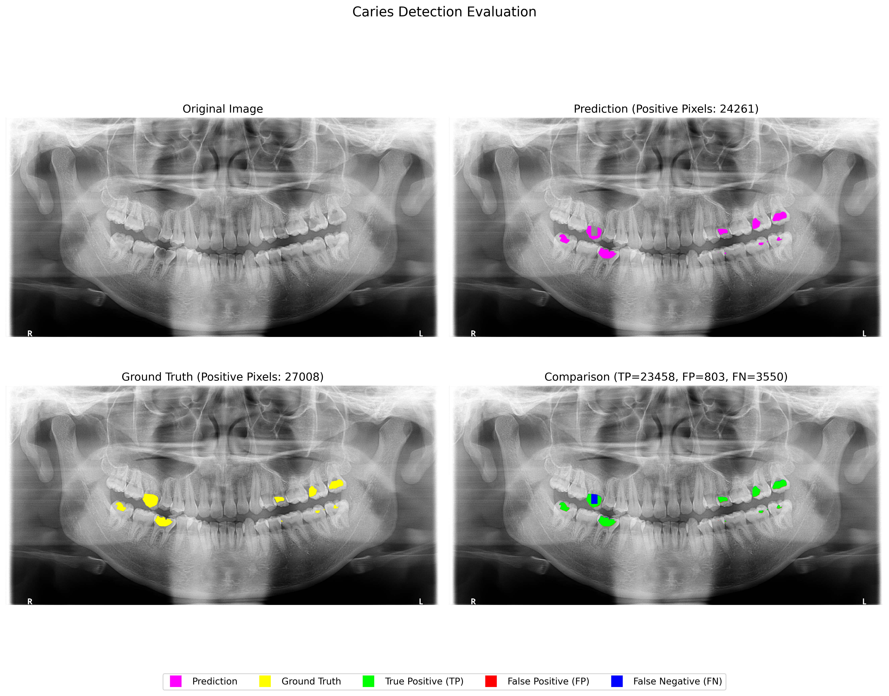

# Dental Panoramic X-Ray — LLM Report Bridge

A real, faculty-supervised dental radiograph analysis system (not a university coursework assignment — the output of this project is actively used by the professor's team). Built together with teammate Sirawich; the professor's team provided the base computer vision pipeline (panoramic tooth detection/segmentation and caries segmentation models). **My own contribution was the LLM bridge: turning the CV pipeline's raw detection output into a readable dental radiology report using a local LLM (Ollama), and wiring that into the existing web app.**

This repository contains only the part of the system I personally wrote — the base CV models, their training code, and the clinical dataset belong to the professor's project and are intentionally not included here.

## What the bridge does

The existing pipeline already detects which teeth have caries (tooth segmentation + caries segmentation models) and outputs a raw per-tooth result. Before my contribution, the app surfaced that raw result directly. My bridge sits between the CV output and the user:

1. **`format_data_for_llm()`** — converts the per-tooth caries detections and confidence scores into a structured findings list (e.g. `Tooth #18: Caries Detected (High confidence, Score: 0.95)`).
2. **`ask_ollama()`** — sends that findings list to a local Ollama server (`llama3.2`) with a constrained prompt that asks for a "Radiographic Findings" + "Conclusion" style report, explicitly instructed not to invent findings beyond the input data.
3. **Integration into `app.py`** — the Flask `/process` endpoint was modified to call the bridge and return the AI-written report instead of the raw detection output, with a safety fallback to the original report if the LLM call fails.

## Demo — detection output the bridge consumes



*Prediction vs. ground-truth caries segmentation on a panoramic X-ray from a public dental research dataset, with a pixel-level TP/FP/FN comparison. This is the kind of per-tooth detection output the LLM bridge formats into a written report.*

## Files in this repository

```
llm_bridge.py   # Core bridge: formats CV output -> prompts a local LLM -> returns a report
test_bridge.py  # Standalone test for the formatter + Ollama connection
app.py          # The project's Flask app, with my LLM-bridge integration (see the
                # "Call LLM Bridge" section). Included for context on how the bridge
                # is wired into the real app — it depends on other modules
                # (dental_analysis_tool.py, evaluation.py, trained model weights)
                # that are part of the base system and not included in this repo.
```

## Tech stack

Python, Flask, OpenCV, [Ollama](https://ollama.com) (local LLM inference, `llama3.2`)
